# Database schema (migrations 0001–0032)

## Entity relationships

```mermaid
erDiagram
    AUTH_USERS ||--|| PROFILES : "1:1 (auto-created)"
    PROFILES ||--o{ SCHOOL_MEMBERSHIPS : "has"
    SCHOOLS ||--o{ SCHOOL_MEMBERSHIPS : "has members"
    ROLES ||--o{ SCHOOL_MEMBERSHIPS : "role key"
    SCHOOLS ||--o{ ACADEMIC_SESSIONS : "runs"
    SCHOOLS ||--o{ CLASSES : "offers"
    CLASSES ||--o{ SECTIONS : "split into"
    ACADEMIC_SESSIONS ||--o{ SECTIONS : "per year"
    SCHOOLS ||--o{ AUDIT_LOGS : "records"
    SCHOOLS ||--o{ STUDENTS : "has"
    STUDENTS ||--o{ STUDENT_ENROLLMENTS : "one per session"
    ACADEMIC_SESSIONS ||--o{ STUDENT_ENROLLMENTS : "per year"
    SECTIONS ||--o{ STUDENT_ENROLLMENTS : "placed in"
    STUDENTS ||--o{ STUDENT_DOCUMENTS : "has"
    SCHOOLS ||--o{ FEE_HEADS : "defines"
    CLASSES ||--o{ FEE_STRUCTURES : "per session"
    ACADEMIC_SESSIONS ||--o{ FEE_STRUCTURES : "per class"
    FEE_STRUCTURES ||--o{ FEE_STRUCTURE_ITEMS : "contains"
    FEE_HEADS ||--o{ FEE_STRUCTURE_ITEMS : "named by"
    STUDENT_ENROLLMENTS ||--o{ STUDENT_FEE_DUES : "owes"
    FEE_STRUCTURE_ITEMS ||--o{ STUDENT_FEE_DUES : "billed as"
    STUDENT_ENROLLMENTS ||--o{ FEE_PAYMENTS : "pays"
    FEE_PAYMENTS ||--o{ FEE_PAYMENT_ALLOCATIONS : "split into"
    STUDENT_FEE_DUES ||--o{ FEE_PAYMENT_ALLOCATIONS : "settled by"
    STUDENT_ENROLLMENTS ||--o{ ATTENDANCE_RECORDS : "marked"
    SECTIONS ||--o{ ATTENDANCE_RECORDS : "that day's section"
    STUDENTS ||--o{ STUDENT_GUARDIANS : "has parent"
    PROFILES ||--o{ STUDENT_GUARDIANS : "is parent of"
    SCHOOLS ||--o{ NOTICES : "publishes"
    SCHOOLS ||--o{ TEACHERS : "employs"
    TEACHERS ||--o{ TEACHER_ASSIGNMENTS : "teaches"
    SECTIONS ||--o{ TEACHER_ASSIGNMENTS : "taught by"
    SCHOOLS ||--o{ NOTIFICATION_EVENTS : "records"
    NOTIFICATION_EVENTS ||--o{ NOTIFICATIONS : "in-app items"
    NOTIFICATION_EVENTS ||--o{ NOTIFICATION_DELIVERIES : "email / SMS / WhatsApp"
    PROFILES ||--o{ NOTIFICATIONS : "receives"
    PROFILES ||--o{ NOTIFICATION_PREFERENCES : "chooses"
    SCHOOLS ||--o{ NOTIFICATION_TEMPLATES : "words"
    SCHOOLS ||--o{ LIBRARY_BOOKS : "catalogue"
    LIBRARY_CATEGORIES ||--o{ LIBRARY_BOOKS : "groups"
    LIBRARY_BOOKS ||--o{ LIBRARY_BOOK_AUTHORS : "written by"
    LIBRARY_AUTHORS ||--o{ LIBRARY_BOOK_AUTHORS : "wrote"
    LIBRARY_BOOKS ||--o{ LIBRARY_COPIES : "copies"
    LIBRARY_COPIES ||--o{ LIBRARY_LOANS : "issued as"
    STUDENTS ||--o{ LIBRARY_LOANS : "borrows"
    TEACHERS ||--o{ LIBRARY_LOANS : "borrows"
    SCHOOLS ||--o| DOCUMENT_SETTINGS : "signatory, signature"
    SCHOOLS ||--o{ CERTIFICATE_TEMPLATES : "wording"
    CERTIFICATE_TEMPLATES ||--o{ CERTIFICATES : "issued from"
    STUDENTS ||--o{ CERTIFICATES : "holds"
    STUDENTS ||--o{ ID_CARDS : "holds"
    TEACHERS ||--o{ ID_CARDS : "holds"
    TRANSPORT_STAFF ||--o{ ID_CARDS : "holds"
    PROFILES ||--o{ PUSH_SUBSCRIPTIONS : "devices"
    NOTIFICATIONS ||--o{ PUSH_OUTBOX : "pushed to each device"
```

| Table | Tenant-scoped | Key relationships | Uniqueness |
|---|---|---|---|
| `schools` | is the tenant | logo in Storage bucket `school-logos` | `code`; UDISE+ code; (board, affiliation number) |
| `profiles` | no (a person can belong to several schools) | `id` → `auth.users.id` | `lower(email)` |
| `roles` | no (global catalogue) | `key` ← `school_memberships.role` | `key` |
| `school_memberships` | `school_id` | → `schools`, → `profiles`, → `roles.key` | `(school_id, user_id, role)` |
| `academic_sessions` | `school_id` | → `schools` | name per school; one `is_current` per school; no overlapping dates; current can't be archived |
| `classes` | `school_id` | → `schools` | name per school among non-deleted rows (case/space-insensitive) |
| `sections` | `school_id` | `(class_id, school_id)` → `classes`; `(academic_session_id, school_id)` → `academic_sessions` | name per class per session among non-deleted rows |
| `students` | `school_id` | photo in private bucket `student-photos` | `student_code` per school (generated) |
| `student_enrollments` | `school_id` | `(student_id, school_id)` → `students`; `(academic_session_id, school_id)` → sessions; `(class_id, school_id)` → classes; `(section_id, class_id, academic_session_id)` → sections | admission number per school + session; one enrollment per student per session |
| `student_documents` | `school_id` | `(student_id, school_id)` → `students`; file in private bucket `student-documents` | `file_path` (must sit in its own school/student folder) |
| `fee_heads` | `school_id` | — | name per school |
| `fee_structures` | `school_id` | `(academic_session_id, school_id)` → sessions; `(class_id, school_id)` → classes (null for the transport structure) | `kind` class / transport: one class structure per class per session; **one transport structure per session** (0023) |
| `fee_structure_items` | `school_id` | `(fee_structure_id, school_id)` → structures; `(fee_head_id, school_id)` → heads | one per head per structure |
| `student_fee_optins` | `school_id` | enrollment + optional fee item | one per enrollment per item |
| `student_fee_dues` | `school_id` | `(enrollment_id, school_id)`; `(fee_item_id, school_id)`; frozen once paid | one per enrollment, item and month |
| `fee_payments` | `school_id` | `(student_id, school_id)`, `(enrollment_id, school_id)`, `(academic_session_id, school_id)` | `receipt_number` and `idempotency_key` per school |
| `fee_payment_allocations` | `school_id` | `(payment_id, school_id)`, `(due_id, school_id)` (restrict) | one per payment per due |
| `attendance_records` | `school_id` | `(enrollment_id, school_id)`, `(student_id, school_id)`, `(section_id, class_id, academic_session_id)` → sections | **one per student per date** |
| `teachers` | `school_id` | `account_id` unique, must be an active teacher of the school, admins only (trigger) | Employee ID and email per school (case-insensitive) |
| `teacher_assignments` | `school_id` | `(teacher_id, school_id)` → teachers; `(section_id, class_id, academic_session_id)` → sections | subject per teacher per section; one class teacher per section |
| `subjects` | `school_id` | — (deactivated, never deleted) | name per school (case-insensitive); code per school |
| `timetable_periods` | `school_id` | `(academic_session_id, school_id)` → sessions; no overlaps within a session (trigger) | period number per session |
| `timetable_entries` | `school_id` | `(section_id, class_id, academic_session_id)` → sections; `(period_id, academic_session_id)` → periods; `(subject_id, school_id)`, `(teacher_id, school_id)` | **`tt_class_slot`** one lesson per section per day+period; **`tt_teacher_slot`** one per teacher per day+period; **`tt_room_slot`** one per room per day+period in the session |
| `homework` | `school_id` | `(section_id, class_id, academic_session_id)` → sections; `(subject_id, school_id)`, `(teacher_id, school_id)`; teacher set by trigger | — |
| `homework_attachments` | `school_id` | `(homework_id, school_id)` cascade | at most 10 per homework (trigger) |
| `homework_submissions` | `school_id` | `(homework_id, school_id)`, `(student_id, school_id)`, `(enrollment_id, school_id)` | **one per student per homework** |
| `homework_submission_files` | `school_id` | `(submission_id, school_id)` cascade | at most 5 per submission (trigger) |
| `exam_types` | `school_id` | — (deactivated, never deleted) | name per school (case-insensitive) |
| `grade_bands` | `school_id` | — | grade and minimum % per school |
| `exams` | `school_id` | `(academic_session_id, school_id)`, `(exam_type_id, school_id)` | name per session |
| `exam_papers` | `school_id` | `(exam_id, academic_session_id)` → exams; `(class_id, school_id)`, `(subject_id, school_id)` | one per class per subject per exam; no overlapping papers for a class (trigger) |
| `exam_marks` | `school_id` | `(paper_id, school_id)`, `(student_id, school_id)`, `(enrollment_id, school_id)`; `section_id` set from the enrollment | **one per student per paper** |
| `report_card_templates` | `school_id` | `exams.report_card_template_id` → template (`on delete set null` for that column only) | name per school; **one default per school** (partial unique index) |
| `report_card_remarks` | `school_id` | `(exam_id, school_id)`, `(student_id, school_id)`, `(enrollment_id, school_id)`; `section_id` set from the enrollment | one per student per exam |
| `transport_vehicles` | `school_id` | — | registration number per school (stored upper-case, no spaces) |
| `transport_staff` | `school_id` | — | driver licence number per school; drivers must have a licence and expiry |
| `transport_documents` | `school_id` | exactly one of `(vehicle_id, school_id)` / `(staff_id, school_id)`, cascade; file in private bucket `transport-documents` | document type allowed for the owner kind |
| `transport_fare_zones` | `school_id` | `(fee_head_id, school_id)` → fee_heads (one head per zone) | name per school; never deleted |
| `transport_routes` | `school_id` | `(vehicle_id, school_id)`, `(driver_id, school_id)`, `(attendant_id, school_id)` | name and code per school |
| `transport_stops` | `school_id` | `(route_id, school_id)` cascade; `(fare_zone_id, school_id)` | name per route |
| `transport_assignments` | `school_id` | `(student_id, school_id)`, `(academic_session_id, school_id)`, `(route_id, school_id)`, `(stop_id, route_id)` → stops (the stop must be on the route) | no overlapping periods per student (trigger); dates inside the session |
| `inventory_items` | `school_id` | `(assigned_teacher_id, school_id)` → teachers | `item_code` per school (INV-00001…, assigned by trigger) |
| `inventory_movements` | `school_id` | `(item_id, school_id)` → items, cascade; `(teacher_id, school_id)` → teachers | append-only; reason must match in / out / change |
| `hr_settings` | `school_id` (primary key) | — | weekly offs (≤ 3), loss-of-pay basis, unmarked days |
| `staff_holidays` | `school_id` | — | one per date per school |
| `leave_types` | `school_id` | — | name and code per school; allowance in half days or none (no limit) |
| `leave_allocations` | `school_id` | `(teacher_id, school_id)`, `(leave_type_id, school_id)`, `(academic_session_id, school_id)` | one per staff × type × session |
| `leave_applications` | `school_id` | `(teacher_id, school_id)`, `(leave_type_id, school_id)`, `(academic_session_id, school_id)` | no overlapping pending/approved leave per staff member (function, under a lock) |
| `staff_attendance` | `school_id` | `(teacher_id, school_id)` | one per staff member per day (primary key) |
| `salary_components` | `school_id` | — | name per school |
| `salary_structures` | `school_id` | `(teacher_id, school_id)` | one per staff member per month (`effective_from` is the 1st) |
| `salary_structure_items` | `school_id` | `(structure_id, school_id)` cascade, `(component_id, school_id)` | a component once per structure |
| `payroll_runs` | `school_id` | — | one per school per month |
| `payslips` | `school_id` | `(run_id, school_id)` cascade, `(teacher_id, school_id)` | one per run per staff member |
| `payslip_adjustments` | `school_id` | `(payslip_id, school_id)` cascade | — |
| `teachers.staff_type`, `designation` | — | — | teaching / non_teaching (decides Teacher vs Staff ID cards); designation 2–60 characters (0026) |
| `document_settings` | `school_id` (primary key) | signature in private bucket `document-assets` (`{school}/signatures/…`) | principal, signatory title, place, accent colour, card validity, card back note |
| `certificate_templates` | `school_id` | — | name per school (case/space-insensitive); prefix 1–6 capital letters; every `{{placeholder}}` known (trigger) |
| `certificates` | `school_id` | `(template_id, school_id)`, `(student_id, school_id)`, `(academic_session_id, school_id)` | number per school; token unique; **one issued transfer certificate per student** (partial unique index) |
| `id_cards` | `school_id` | exactly one of `(student_id, school_id)`, `(teacher_id, school_id)`, `(transport_staff_id, school_id)` (cascade) | token unique; **one active card per person** (partial unique index) |
| `push_subscriptions` | — (a person's device; not tied to a school) | `user_id` → `profiles` (cascade) | push address unique (a device belongs to whoever registered it last); at most 10 per person |
| `private.push_outbox` | — | `notification_id` → `notifications`, `subscription_id` → `push_subscriptions` (both cascade) | one per notification per device |
| `students.account_id` | — | unique; must be an active student of the same school; admins only (trigger) | one login per student |
| `student_guardians` | `school_id` | `(student_id, school_id)` → students; account must be an active parent of the school (trigger) | one link per student per account |
| `notices` | `school_id` | `class_ids` checked against the school by the API | — |
| `audit_logs` | `school_id` (nullable for platform events) | → `schools`, actor → `auth.users` | — |

**Why sections are per session:** classes (Nursery … Class 12) are stable for years,
but sections change every year (a new "C" section, a different room or capacity).
Tying sections to a session keeps last year's structure intact, so future student
enrolments, attendance and results always refer to the section as it was then.

**Deletes:** deleting a school removes all of its data. Classes and sections
use **soft deletion** (`deleted_at`, `deleted_by`); users have no hard-delete
policy for them. Guard triggers refuse to soft-delete a class that still has
sections, or a section that has students. They also make archived sessions'
sections read-only, and stop sections being added to inactive or deleted classes.
Sessions are guarded by the `guard_session_delete` trigger: a session that is
current, or that any table references (found automatically through foreign keys),
cannot be deleted. Archive it instead (`archived_at`).

## Tenant isolation — three independent layers

1. **RLS** on every tenant table: rows are visible only to active members of an
   active school (or the platform super admin). A suspended school's members lose
   access immediately.
2. **Composite foreign keys** `(id, school_id)`: a section can only reference a
   class and a session of its own school. This holds even for code running with
   full database rights, so an application bug cannot mix two schools' data.
3. **`prevent_school_change` trigger**: `school_id` can never be changed on an
   existing row.

## Access matrix

| Table | Read | Create / edit / delete |
|---|---|---|
| `schools` | super admin; members of that (active) school | super admin |
| `profiles` | self; super admin; admins of a school the person belongs to | self (name, phone, avatar only) |
| `roles` | any signed-in user | nobody (migrations only) |
| `school_memberships` | self; super admin; that school's admins | super admin; that school's admins |
| `academic_sessions` | super admin; any active member of the school | super admin; that school's admins |
| `classes`, `sections` | super admin; any active member of the school | super admin; that school's admins (no hard delete) |
| `students`, `student_enrollments` | super admin; that school's admins, accountants, teachers | super admin; that school's admins (no delete) |
| `fee_heads`, `fee_structures`, `fee_structure_items` | super admin; that school's admins and accountants | same (heads: no delete) |
| `student_fee_dues`, `student_fee_optins` | super admin; that school's admins and accountants | same |
| `fee_payments`, `fee_payment_allocations` | super admin; that school's admins and accountants | **insert only**, via `record_fee_payment` (never updated or deleted) |
| `attendance_records` | super admin; that school's admins and teachers | same (insert/update; no delete) |
| `student_guardians` | the parent themself; that school's admins | admins only |
| students, enrollments, attendance, dues, receipts (+ lines), billed fee heads/items | **parents: own children; students: themselves** (`can_view_student_record`), read-only | — |
| `notices` | staff: all; parents: live notices for parents/everyone and their children's classes; students: live notices for students/everyone and their own class | admins only |
| students, enrollments | admins and accountants: whole school; **teachers: assigned sections only** | admins |
| attendance | admins: whole school; **teachers: assigned sections only** | same |
| classes, sections | admins, accountants, parents, students: whole school; **teachers: assigned only** | admins |
| `teachers` | admins; a teacher sees their own record | admins (no delete) |
| `teacher_assignments` | admins; a teacher sees their own | admins |
| `subjects`, `timetable_periods` | any active member of the school | admins (subjects: no delete) |
| `timetable_entries` | admins and accountants: whole school; **teachers: assigned sections**; **parents/students: their own child's / own class** (`can_view_section_timetable`) | admins only |
| `homework`, `homework_attachments` | admins; **teachers: assigned sections**; parents/students: their child's / own section (`can_view_section_homework`) | admins; teachers only for assigned sections and **only their own** (`can_manage_homework`) |
| `homework_submissions` (+ files) | the student and their parents (`can_view_student_record`); the homework's teacher; admins | insert/update by **the student themself** (answer only, before the deadline, until reviewed); update by the homework's teacher/admin (**marks and feedback only**); never deleted |
| Storage `homework-files` | **nobody directly**: streamed by the API after the checks above | server only (service role) |
| `exam_types`, `grade_bands` | any active member of the school | admins |
| `exams`, `exam_papers` | admins and teachers: all; other members: **not drafts** | admins |
| `exam_marks` | admins; **teachers: assigned sections**; parent/student: **own, only when published** | admins; teachers for assigned sections; never once published |
| `report_card_templates` | any active member of the school | admins (the default can't be deleted) |
| `report_card_remarks` | admins; teachers of the section; parent/student own **once published** | teacher remarks: admins and the section's teachers; **principal remarks: admins only** (trigger); locked once published |
| Storage `report-card-assets` | **nobody directly**: read by the server for PDFs | server only (service role) |
| `admission_windows` | admins and accountants | admins |
| `admission_applications` | admins and accountants | **created only by `intake.submit_admission`** (no insert grant); update: admins (workflow, corrections), accountants **only approved → fee_paid** with the fee columns (trigger); never deleted |
| `admission_documents`, `admission_events` | admins and accountants (through the application) | documents: written by `intake.submit_admission`; events: written by trigger only |
| `admission_enquiries` | admins and accountants | insert/update: admins and accountants; delete: admins only |
| `admission_enquiry_activities` | admins and accountants (through the enquiry) | written by trigger only; never edited |
| `online_payments` | admins and accountants; parents: their own children's | nobody directly: created by `prepare_online_payment` (parents, after checks), updated only by `pay_*` functions run as `erp_payments` |
| `online_payment_refunds` | through the payment | `pay_record_refund` / `pay_refund_update` only |
| `payment_webhook_events` | admins and accountants | `pay_log_event` only |
| `private.payment_gateway_accounts` | **nobody** (not even admins); the API reads it as `erp_payments` | `save_gateway_account` (school admins); secrets arrive already encrypted |
| `notification_events`, `notification_deliveries` | school admins | nobody directly: events by triggers / `notify_enqueue`, deliveries by `notify_store` and the `erp_notify` sender functions |
| `notifications` (in-app) | **the recipient only** (admins see counts via `notify_in_app_stats`) | recipient: mark read (`read_at` only), delete; created only by `notify_store` |
| `notification_templates`, `notification_settings` | school admins | school admins |
| `notification_preferences` | the person themself | the person themself |
| `private.messaging_accounts` | **nobody** (not even admins); the sender reads it as `erp_notify` | `save_messaging_account` (school admins); tokens arrive already encrypted |
| `library_settings` | any member of the school | school admins |
| `library_categories`, `library_authors`, `library_books`, `library_book_authors` | any member of the school (the catalogue isn't private) | admins and librarians; books with copies, and categories/authors in use, can't be deleted |
| `library_copies` | any member of the school | added only by `library_add_copies`; accession no., price, date and note editable by admins/librarians; status only through `library_set_copy_status` and circulation; a copy ever issued can't be deleted |
| `transport_vehicles`, `transport_staff`, `transport_fare_zones`, `transport_routes`, `transport_stops` | admins and accountants (the API shows accountants only names, phones and routes of staff) | admins; zones: insert only via `transport_add_zone`, no delete; used routes/stops/vehicles/staff can't be deleted |
| `transport_documents` | **admins only** | admins (title, number and dates editable; the file can't be swapped) |
| `transport_assignments` | admins and accountants; **parents/students: their child's / their own** (`can_view_student_record`) | nobody directly: `transport_assign`, `transport_update_assignment`, `transport_end` |
| Storage `transport-documents` | **nobody directly**: the API streams files to admins (audited) | server only (service role) |
| `inventory_items` | admins and accountants; **staff: items assigned to them** (`current_teacher_id`) | admins; insert/update of every column except `quantity` and `item_code`; delete only an item with at most its first stock movement |
| `inventory_movements` | admins and accountants | nobody directly: `inventory_move` (stock in/out) and the `inventory_items_changed` trigger (changes); never edited or deleted |
| `hr_settings`, `staff_holidays`, `leave_types` | any member of the school | school admins (`is_hr_admin`); holidays of a finalized month are locked |
| `leave_allocations`, `staff_attendance` | school admins; **staff: their own** (`current_staff_id`) | school admins; attendance of a finalized month is locked |
| `leave_applications` | school admins; **staff: their own** | nobody directly: `leave_apply`, `leave_decide`, `leave_cancel`; never deleted |
| `salary_components`, `salary_structures`, `salary_structure_items` | **the school's own admins only** (`is_payroll_admin` — not super admins) | the same |
| `payroll_runs`, `payslips`, `payslip_adjustments` | **the school's own admins only** | nobody directly: `payroll_generate`, `payroll_adjust`, `payroll_remove_adjustment`, `payroll_set_status`; a draft run can be deleted |
| `document_settings`, `certificate_templates` | school admins and super admins (`is_documents_admin`) | the same; a template with certificates can't be deleted (switch it off) |
| `certificates` | school admins and super admins | nobody directly: `certificate_issue`, `certificate_revoke`; never edited (except revoking) or deleted |
| `id_cards` | school admins and super admins | nobody directly: `id_card_issue`, `id_card_revoke`; never edited (except replacing / revoking) or deleted |
| Storage `document-assets` | **nobody directly**: the server reads the signature to print it | server only (service role) |
| `push_subscriptions` | **only the person themselves** (`user_id = auth.uid()`) | create/refresh only through `push_subscribe` (as yourself); change only `show_preview` and `device_label`; delete your own |
| `private.push_outbox` | nobody (the sender, `erp_notify`, through `push_claim`) | the trigger on `notifications`; `push_result` (sender only) |
| `library_loans` | admins, librarians and accountants: all; **teachers: their own**; **parents/students: their child's / their own** (`can_view_student_record`) | nobody directly: `library_issue`, `library_return`, `library_renew`, `library_collect_fine`, `library_waive_fine`; never deleted |
| Storage `admission-files` | **nobody directly**: streamed/copied by the API after the checks above | server only (service role) |
| Storage `school-logos` | public (logos only) | server only (service role) |
| `student_documents` | super admin; that school's **admins only** | super admin; that school's admins (file itself can't be swapped) |
| Storage `student-documents` | **nobody directly**: the API streams files after checking access | server only (service role) |
| Storage `student-photos` | **nobody directly**: server issues 1-hour signed links | server only (service role) |
| `students` | `school_id` | photo in private bucket `student-photos` | `student_code` per school (generated) |
| `student_enrollments` | `school_id` | `(student_id, school_id)` → `students`; `(academic_session_id, school_id)` → sessions; `(class_id, school_id)` → classes; `(section_id, class_id, academic_session_id)` → sections | admission number per school + session; one enrollment per student per session |
| `audit_logs` | that school's admins (payroll entries: its payroll admins only); super admin (all but payroll; platform-level entries) | nobody: written by the API and by database triggers inside each change; append-only, even for the owner (0032) |
| *all tables* | anonymous users: **no access** (the public admission form uses only the three `intake` functions below) | — |

Teachers, accountants, parents and students can read their school's academic
structure. Their write access to their own modules arrives with those modules.

## Helper functions (schema `private`, not exposed by the Supabase REST API)

| Function | Purpose |
|---|---|
| `is_super_admin()` | platform admin flag of the caller |
| `is_school_member(school_id)` | caller has an active membership in an active school |
| `has_school_role(school_id, roles[])` | as above, limited to the given roles |
| `set_current_academic_session(id)` | switch a school's current session atomically (RLS-checked; refuses archived) |
| `academic_session_usage(id)` | which tables hold records for a session, with counts (only for sessions you can see) |
| `fee_structure_schedule(id)` | every due month of every item, from the session's dates |
| `fee_item_breakdown(id)` / `fee_structure_totals(ids[])` | per-item yearly amounts; compulsory/optional/monthly/one-time totals |
| `copy_fee_structure(...)` | copy with % change and rounding, in SQL |
| `sync_student_dues(ids[])` | builds/refreshes unpaid dues from active structures and opt-ins |
| `student_fee_status(id)` / `enrollment_fee_totals(ids[])` | per due: amount, paid, balance; per enrollment: total, paid, outstanding, overdue |
| `record_fee_payment(...)` | the only way a payment is written: locks dues, refuses overpayment, numbers the receipt, idempotent |
| `save_section_attendance(section, date, entries)` | saves a whole section in one upsert; returns added / changed / unchanged |
| `attendance_daily`, `attendance_student_totals`, `attendance_section_days`, `attendance_student_months` | the attendance reports |
| `teacher_assigned_section(section)`, `teacher_sees_class(class)`, `teacher_sees_student(student)` | is the signed-in user an active, linked teacher assigned to it? |
| `can_view_section_timetable(section)` | admin/accountant of the school, assigned teacher, or parent/student of a student enrolled there |
| `teacher_display_name(teacher)` | a teacher's name for timetable cells, without opening the staff table to parents/students |
| `current_teacher_id(school)` | the signed-in user's active, linked teacher record |
| `can_view_section_homework(section)` | admin, assigned teacher, or parent/student of a student enrolled there |
| `can_manage_homework(homework)` | admin, or the teacher who set it while still assigned to that class |
| `grade_for(school, pct)` | the grade for a percentage on the school's scale |
| `exam_results(exam, section)` / `exam_result_marks(exam, section)` | totals, %, grade, pass/fail/incomplete, rank; subject marks, grades and pass. Staff get the whole section; parents/students only their own rows, after publication |
| `class_teacher_name(section)` | the section's class teacher, for report cards (school members only) |
| `exam_published(exam)` | has the exam's result been published (families see remarks only then) |
| `is_student_self(student)` | is the signed-in user this student (via `students.account_id`)? |
| `can_view_student_record(student)` | linked parent **or** the student themself; every portal read policy uses it |
| `sync_dues_for_portal(student)` | refreshes dues for a parent/student after checking access |
| `is_guardian_of(student)` | is the signed-in user an active, linked parent of this student? (all parent policies use it) |
| `sync_dues_for_guardian(student)` | refreshes a child's dues for their parent, after checking the link |
| `find_account_by_email(school, email)` | admins only: id of an existing account to link as a parent |
| `section_student_counts(ids[])` | enrollments per section (feeds counts and the "has students" guards) |
| `write_audit_log(...)` | server-side audit insert; actor taken from the JWT |

## Timetable rules (migration 0013)

- **Clashes are impossible at the database level.** Three unique indexes on
  `timetable_entries`: `tt_class_slot (section_id, day_of_week, period_id)`,
  `tt_teacher_slot (teacher_id, day_of_week, period_id) where teacher_id is not null`,
  `tt_room_slot (academic_session_id, day_of_week, period_id, lower(room)) where room is not null`.
  A period belongs to one session, so the same period id never spans two sessions.
- **`guard_timetable_entry` trigger:** stores rooms trimmed and upper-case;
  refuses archived sessions, inactive/deleted sections, break periods, inactive
  subjects or teachers, and a teacher who has no assignment in that section.
- **`guard_period` trigger:** no overlapping periods within a session; archived
  sessions read-only; a period with lessons can't be deleted or made a break.
- **`guard_assignment_timetable` trigger:** a teacher assignment can't be
  removed while that teacher still has lessons in the section.
- `day_of_week` is ISO: 1 = Monday … 7 = Sunday.
- Test: `supabase/tests/timetable_test.sql`.

## Homework rules (migration 0014)

- **`guard_homework`**: sets `teacher_id`/`created_by` from the signed-in user (never the caller's
  values); deadlines must be in the future when set or changed; inactive sections/subjects refused;
  archived sessions read-only; no deleting or moving homework that has submissions; the maximum
  can't drop below an awarded mark.
- **`guard_submission`**: a student may only insert/update their own work, for their own section,
  before the deadline (or late if allowed, then `is_late`), until reviewed; `submitted_at`/`is_late`
  are set by the database. Staff may change only `marks` and `feedback` (marks ≤ maximum; none
  when the homework isn't marked); `reviewed_at`/`reviewed_by` are stamped automatically.
- **`guard_submission_file`**, **`guard_homework_attachment`**: same deadline/review/archive rules for
  files, and the 5 / 10 file limits.
- **`guard_assignment_homework`**: a teacher assignment can't be removed while that teacher has
  unreviewed work in the class.
- Test: `supabase/tests/homework_test.sql`.

## Exam rules (migration 0015)

- **`guard_exam`**: new exams start as drafts; scheduling needs a date sheet; publishing needs a
  mark (or "absent") from every active student for every paper of their class, and is
  time-stamped; exams with marks can't be deleted; archived sessions are read-only.
- **`guard_exam_paper`**: dates within the session; passing ≤ maximum marks; no overlapping papers
  for a class on a day (any exam of the session); no changes once published; a paper with marks
  can't be removed or change class/subject, and its maximum can't drop below an awarded mark.
- **`guard_exam_mark`**: marks between 0 and the paper's maximum, at most 2 decimals, marks XOR
  absent; the student must be enrolled in the paper's class and session; `section_id` comes from
  the enrollment (RLS relies on it); no changes once results are published.
- Test: `supabase/tests/exams_test.sql`.

## Report card rules (migration 0016)

- **`guard_report_card_template`**: trims names/titles, stores colours lower-case, and refuses to
  delete the default template.
- **`guard_report_card_remarks`**: `section_id` from the enrollment (the student must be enrolled in
  the exam's session); only admins may set or change `principal_remarks`; no changes once the
  exam's results are published or the session is archived.
- Test: `supabase/tests/report_cards_test.sql`.

## Online admission (migration 0017)

**Tables:** `admission_windows` (per session + class: `is_open`, `seats`, `admission_fee`,
`last_date`, `instructions`; unique per session/class), `admission_applications` (student,
parents, address, previous school, photo path, class/session, review and decision fields,
fee fields, `student_id` once created; `application_number` unique per school),
`admission_documents` (type, file name/type/size, path in `admission-files`) and
`admission_events` (from/to status, note, actor, time).

**Public functions, schema `intake`** (`anon` and `authenticated` may execute only these;
`security definer`, fixed `search_path`; `anon` has no table access at all):
- `intake.admission_form(code)` — school name/address/logo and the windows that are open,
  not past their last date and in a non-archived session, with seats left.
- `intake.submit_admission(code, data)` — validates the window, creates the application
  (`ADM<session start year>-<00001>`, counter per session in `private.school_counters`)
  and its documents. The same child (name + date of birth + last 10 digits of the mobile)
  with an application that isn't rejected is refused. At most 8 documents.
- `intake.admission_status(code, number, phone)` — only when the number **and** the contact
  mobile match: status, class, fee, receipt number, dates of each step; a note only for a
  rejection (the reason). Internal notes are never returned.

**Rules (`private.guard_admission`):**
- Allowed moves only: submitted → under_review | rejected; under_review → verified | rejected;
  verified → approved | rejected; approved → fee_paid | rejected; fee_paid → enrolled;
  rejected → under_review (reopen; clears the reason).
- Rejecting needs a reason. Approving checks `seats` (approved + fee_paid + enrolled) and copies
  the window's fee into `fee_amount`.
- fee_paid: the amount must equal `fee_amount`; a payment mode when it is above 0; a paid-on date
  not in the future; receipt number `ADR-<00001>` generated per school.
- enrolled needs `student_id` and is final. The class can't change after approval; a recorded
  payment can't be changed.
- Accountants may only move approved → fee_paid and set the fee columns (otherwise 42501).
- `private.log_admission_event` writes an event row on submission and on every status change.
- Test: `supabase/tests/admissions_test.sql`.

## Admission CRM rules (migration 0018)

**Tables:** `admission_enquiries` (enquiry number, session, date, parent and student name,
phone, email, interested class, source + detail, status, follow-up date, notes, linked
`application_id`) and `admission_enquiry_activities` (kind: created / status / follow_up /
note / linked / unlinked, from/to status, follow-up date, note, actor, time).

**`private.guard_enquiry`** (before insert/update):
- numbers enquiries `ENQ-<00001>` per school (`private.school_counters`, kind `enquiry`); the
  number, creator and creation time can't change;
- refuses enquiries in an archived session;
- "follow_up" needs a date; a new follow-up date can't be in the past; rejected/admitted clear it;
- linked to an application: the status is the application's (`private.enquiry_status_for`), and
  a different status set by hand is refused;
- writes the history row for a status change, a new follow-up date, a link/unlink, or a note
  (`activity_note`, which is never kept on the enquiry).

**`private.sync_enquiry_from_application`** (after insert / status change on
`admission_applications`): links a new application to the one open, unlinked enquiry of the
same session with the same mobile (last 10 digits), and passes every status change on to the
linked enquiry (skipped for archived sessions).

Test: `supabase/tests/enquiries_test.sql`.

## Online payment rules (migration 0019)

**Tables:** `private.payment_gateway_accounts` (per school: Razorpay key id, key secret and
webhook secret **encrypted by the API**, on/off), `online_payments` (student, enrollment,
amount, the fees it pays as `allocations`, Razorpay order and payment ids, status, method,
receipt link), `online_payment_refunds`, `payment_webhook_events` (event id, type, order and
payment ids, outcome; no payer details). `fee_payments` gains `cancelled_at`, `cancelled_by`,
`cancel_reason`, `cancelled_allocations`; payment mode `online` is added.

**For parents and staff (granted to `authenticated`):**
- `prepare_online_payment(student, due ids)` — guardian only; gateway on; every fee this
  student's, one enrollment, open session, nothing already paid; the amount is the outstanding
  balance of those fees; reuses the same order for the same fees within 30 minutes; at most 20
  orders per student per hour.
- `save_gateway_account` (school admins; empty secret = keep), `gateway_account_info` (key id,
  mode, on/off — never the secrets), `online_payments_enabled`.

**Gateway results (granted only to the role `erp_payments`):** `pay_gateway_secrets`,
`pay_attach_order`, `pay_cancel`, `pay_find`, `pay_apply`, `pay_mark_failed`,
`pay_lock_for_refund`, `pay_record_refund`, `pay_refund_update`, `pay_log_event`,
`pay_event_outcome`.
- `pay_apply` locks the order; the same Razorpay payment again returns the same receipt; a
  different payment for a paid order is refused; an amount different from the order is parked
  as `needs_review`; otherwise it records the receipt through `record_fee_payment` (idempotency
  key = the order id). If the fees can no longer take the money (paid meanwhile, session closed),
  the payment is parked as `needs_review` with the reason, never applied partly.
- Receipt numbers: `next_counter` also accepts a one-off grant that `pay_apply` writes to
  `private.counter_grants` for its own transaction id (no one else can write that table).
- `pay_record_refund`: full refunds only, of `paid`, `needs_review` or `refund_failed`
  payments; cancels the receipt (moves its allocations to `cancelled_allocations`) so the
  fees are due again. `pay_refund_update` completes or fails a refund once.
- `pay_log_event`: true only the first time an event id is seen (webhook retries are skipped).

Test: `supabase/tests/payments_test.sql`.

## Notification rules (migration 0020)

**Tables:** `notification_events` (one row per thing worth telling people about: event key,
payload with ids only, status pending → processing → done / skipped / failed, number of
people; unique `(school_id, dedupe_key)` so the same payment, absence, homework… is never
announced twice), `notifications` (in-app items: user, title, body, a relative link only),
`notification_deliveries` (one per channel and address: email / sms / whatsapp, rendered
subject and body or WhatsApp template and values, status queued → sending → sent → delivered
→ read, or failed / skipped, attempts, next attempt time, provider message id, error),
`notification_templates` (per school, event and channel: on/off, wording, WhatsApp template
name, language and values), `notification_settings` (email on/off, reply-to, quiet hours,
automatic fee-reminder days 1–28, SMS and WhatsApp daily limits),
`notification_preferences` (per person: email / SMS / WhatsApp on or off),
`private.messaging_accounts` (per school: Twilio or Meta configuration, encrypted token and
app secret, WhatsApp verify token).

**Events are written by triggers in the same transaction** as the change:
fee receipt inserted → `payment_received`; attendance marked absent for today or yesterday →
`student_absent` (one per student per day); homework inserted → `homework_assigned`; exam
draft → scheduled → `exam_scheduled`; exam published → `results_published` (once a day);
admission application event → `admission_update`; notice published (or its publish time
reached, via `notify_due_notices`) → `notice_published`. Fee reminders come from
`send_fee_reminders(school, class)` (admins, accountants) or `notify_auto_fee_reminders()`
on the chosen days after 9 am India time; both bring dues up to date first and enqueue one
reminder per student with overdue fees per India day.

**Who receives what** is decided in SQL by `notify_event_context(event)` when the message is
prepared (so a corrected absence, a deleted notice or fees paid meanwhile are skipped):
guardian accounts (`notify_family`) plus, when none has a phone, the mobile on the student
record; student logins for homework, exams and notices for students; staff for staff
notices; the applicant's contact details for admissions. Notice audiences and class lists
are respected.

**Sender functions (granted only to the role `erp_notify`):** `notify_claim_events`,
`notify_event_context`, `notify_school_setup`, `notify_opt_outs`, `notify_store`,
`notify_claim_deliveries` (SKIP LOCKED; reclaims messages stuck in "sending" for 10 minutes),
`notify_channel_secrets`, `notify_sent_today`, `notify_delivery_result` (a retry time
re-queues), `notify_delivery_status` (provider reports only move a message forward:
sent → delivered → read, or to failed), `notify_due_notices`, `notify_auto_fee_reminders`.

**For staff (granted to `authenticated`, checked inside):** `send_fee_reminders`,
`save_messaging_account` / `messaging_account_info` (admins; never the secrets),
`notify_retry` (admins; failed or skipped messages only), `notify_test` (admins),
`notify_in_app_stats` (admins: how many in-app items were sent and read).

Test: `supabase/tests/notifications_test.sql`.

## Library rules (migrations 0021–0022)

**Role:** `librarian` (0021 adds the enum value on its own; 0022 adds the role row). The API gives
it to a staff login as "Library duty"; it reaches the library only. `is_library_staff(school)` =
admin or librarian; `can_collect_library_fines(school)` adds accountants.

**Tables:** `library_settings` (per school: loan days and book limits for students and staff, fine
per day — 0 means no fines — grace days, optional maximum fine per book, renewals, whether overdue
books / unpaid fines block new loans), `library_categories`, `library_authors`, `library_books`
(ISBN normalised to ISBN-13 by a trigger using `private.isbn13`, which checks ISBN-10 and -13 check
digits; unique per school), `library_book_authors`, `library_copies` (accession number unique per
school, case-insensitive; status available / issued / lost / damaged / withdrawn; optional price),
`library_loans` (copy, book, exactly one borrower — student or staff — with name, ID and class copied
at issue; issue / due / return dates; condition; renewals; the fine rate, grace days and cap in force
at issue; fine and book charge; fine status none / unpaid / paid / waived with payment mode,
reference, receipt number, or waiver reason).

**Guards (for everyone, including the functions):** one open loan per copy (partial unique index);
a copy is "issued" only with an open loan and can't change status while on loan; a loan's borrower,
copy, issue date and fine rules never change, a returned loan is final, a settled fine stays settled,
and loans are never deleted (a maintenance-only escape, `set library.allow_delete = on`, exists for
clearing test schools — app users have no delete right on loans at all).

**Functions (granted to `authenticated`, checked inside):**
- `library_add_copies(book, count, accession numbers?, price, acquired)` — typed numbers, or the next
  ACC-000001… (skipping numbers already typed by hand); at most 100 at a time.
- `library_set_copy_status(copy, status, note)` — available / damaged / lost / withdrawn, not while on loan.
- `library_find_borrowers(school, q)`, `library_borrower(school, kind, id)` — current-session students
  and active staff, with books out, overdue count and amount owed; for library staff only (they can't
  read student or staff tables).
- `library_issue(copy, student, teacher, due)` — locks the copy and the borrower; checks availability,
  an active current-session student or active staff member, the limit, one copy per title, overdue
  books and unpaid fines (if the rules say so) and the due date (today … a year ahead).
- `library_return(loan, condition, date, charge, note)` — fine = `library_fine(due, returned, rate,
  grace, cap)` = days late beyond the grace days × rate, capped; lost = the given charge or the copy's
  price (one of them is required); the copy becomes available / damaged / lost.
- `library_renew(loan)` — not overdue, within the renewals allowed; adds another loan period to the due date.
- `library_collect_fine(loan, mode, reference)` — admins, librarians, accountants; the whole amount;
  a reference unless cash; receipt LIB-000001…
- `library_waive_fine(loan, reason)` — school admins only, with a reason.
- `library_loan_due(loan)` — an open loan's fine so far (as of today, India time) or a returned loan's unpaid amount.
- `library_dashboard(school)` — every dashboard figure (admins, librarians, accountants).
- `notify_library_overdue()` — run by the notification sender (`erp_notify`): one `library_overdue`
  event per overdue student loan, from 9 am India time; the event is skipped if the book is returned first.

Test: `supabase/tests/library_test.sql`.

## Transport rules (migration 0023)

**Fee integration.** `fee_structures` gains `kind` (`class` | `transport`); `class_id` is null for
the transport kind (check constraint), with at most one transport structure per session (partial
unique index). `private.transport_structure(school, session)` creates it on demand. Each fare zone
owns a fee head *Transport – zone* and one item in every open session's transport structure, kept in
step by the `transport_zone_changed` trigger (name, amount, frequency, months, active).
`private.wanted_dues(ids)` — used by the existing dues sync — now also returns
`private.transport_wanted_dues(ids)`: for each enrollment of an active student in an open session,
one due per billing month covered by a `charge_fee` assignment, at the zone of the assignment's stop;
a month in which a later assignment starts belongs to the later one. The ordinary sync then adds,
re-prices or removes **unpaid** dues; paid dues never change. So the fee desk, receipts, online
payments, reports and reminders need no transport-specific code.

**Guards.** Items of a transport structure change only while `erp.transport_sync = on` (set inside
the transport functions); the transport structure itself can't be edited or deleted otherwise; zone
fee heads can't be used in class structures; the API's fee-head list hides them.
- `transport_route_guard`: a running route can't have a retired vehicle; changing the vehicle checks
  its seats against the route's riders; the driver must be an active driver whose licence hasn't
  expired; the attendant an active attendant.
- `transport_in_use_guard`: staff on a running route can't be made inactive or change role; a vehicle
  on a running route can't be retired; seats can't drop below current riders.
- `transport_assignment_guard`: dates inside the session; the student enrolled in it; no overlapping
  periods (daterange); student and session never change.
- `transport_stops_zone_changed`: moving a stop to another zone re-syncs its riders' dues.

**Functions (granted to `authenticated`, checked inside):**
- `transport_add_zone(school, name, amount, frequency, months, due month)` — school admins; creates the fee head.
- `transport_assign(student, route, stop, trip, start, charge_fee, notes)` — school admins; an advisory
  lock per route; checks the route is running, the stop is on it, the student is active and enrolled in
  an open session containing the start, and seats (riders on the later of start and today, excluding
  this student); the assignment running on the start date ends the day before (refused if it starts that
  same day, or if a later one exists); then syncs the student's dues.
- `transport_update_assignment(assignment, stop, trip, charge_fee, notes)` — same route only.
- `transport_end(assignment, end)` — sets the last day; with no date, deletes an assignment that hasn't started.
- `transport_route_riders(route, on)` — active students riding on a date.
- `transport_for_student(student)` — the family view: route, stop, times, zone and fare, vehicle, and the
  driver's and attendant's names and phones; for `can_view_student_record`, admins and accountants.
- `transport_dashboard(school, session)` — counts, expiring documents and licences (30 days), full
  routes, and the session's transport fees (billed, due till now, collected, overdue); admins and accountants.

Test: `supabase/tests/transport_test.sql`.

## Inventory rules (migration 0024)

**Tables.** `inventory_items` — code, name, category (computer, furniture, laboratory, sports,
stationery, electronics, other), unit (counted: piece, set, pair, box, pack, ream, dozen, roll,
bottle; measured: kg, litre, metre), brand/model, serial number, description, `quantity` (≥ 0),
reorder level, cost per unit, purchase date, vendor, location, condition (new, good, fair,
needs_repair, damaged, unusable), assigned staff member, `is_active` (false = archived), notes.
`inventory_movements` — kind `in` (opening, purchase, donation, returned, found, adjustment), `out`
(issued, consumed, damaged, lost, disposed, returned_to_vendor, adjustment) or `change` (details),
quantity (> 0 for in/out, 0 for change), `balance_after`, date, cost per unit and a generated
`total_cost` (stock in only), vendor, reference, staff member or recipient, note, `changes` jsonb
for change rows, recorded by.

**Triggers.**
- `inventory_item_before`: on insert, the next code per school under an advisory lock and quantity
  forced to 0; codes never change; names and locations tidied; the assignee must be active staff.
- `inventory_items_changed` (after update): logs location, condition, assignee (by name), name and
  archiving changes as a `change` movement.
- `inventory_item_delete_guard`: an item with more than one stock movement is kept (archive it);
  `set inventory.allow_delete = on` is a maintenance-only escape for clearing test schools.
- `inventory_movements_locked`: history can't be updated or deleted by anyone, except when its item
  (or school) is being deleted.

**Functions (granted to `authenticated`, checked inside).**
- `inventory_move(item, kind, reason, quantity, date, unit cost, vendor, reference, staff, recipient,
  note)` — school admins; locks the item; refuses archived items, quantities ≤ 0 or with more than
  2 decimals, fractions of counted units, future dates (India time), taking out more than is in
  stock, cost/vendor on stock out, inactive or other-school staff, and an issue with no recipient;
  writes the movement with the new balance; a purchase or opening stock dated on or after the
  item's purchase date updates its purchase date, cost and vendor.
- `inventory_dashboard(school)` — admins and accountants: counts, stock value, low / out of stock,
  needs attention, purchases this month and financial year, by category, and the two short lists.

Test: `supabase/tests/inventory_test.sql`.

## Staff leave and payroll rules (migration 0025)

**Who.** `is_hr_admin(school)` = school admin (or super admin) — leave, holidays, staff attendance.
`is_payroll_admin(school)` = **school admin of that school only**; platform super admins are
deliberately not included. `current_staff_id(school)` = the signed-in person's active staff record
(any staff role: admin, accountant, teacher, librarian).

**Working days.** `hr_working_day(school, day)`: not a weekly off (`hr_settings.weekly_offs`, ISO
1–7, default Sunday) and not a holiday. `leave_days(school, from, to, half)` counts them (½ for a
half day).

**Leave.** `leave_balance(staff, type, session)` → allowance (the person's allocation, else the
type's; null = no limit), used (approved), pending, available. `leave_apply(school, staff|null,
type, from, to, half, reason)`: staff apply for themselves (`current_staff_id`), admins for anyone;
active type and staff; ≤ 6 months; half days only for one day of a type that allows them; within one
academic session; not in a finalized payroll month; at least one working day; an advisory lock per
staff member; no overlap with pending or approved leave; within the available balance.
`leave_decide(app, approve, note)`: admins; pending only; **not your own leave**; a rejection needs
a reason; the balance is checked again on approval; not in a finalized month. `leave_cancel(app,
note)`: the staff member (pending, or approved and not started) or an admin; not in a finalized
month. A trigger keeps a leave's dates, type, days and staff fixed, decided leave final, and
history undeletable (maintenance escape `set hr.allow_delete = on`, for clearing test schools).

**Payroll.** `payroll_generate(school, month)` (not a future month; a draft only) creates or
recalculates the month's payslips for active staff with a structure in force on the month's last
day: per working day — before joining → loss of pay; approved leave (paid / unpaid, half days
count ½ and the other half as worked) → otherwise attendance (present / absent / half day /
unmarked). LOP = absent + ½ half days + unpaid leave + days before joining (+ unmarked, if
`unmarked_as = 'absent'`), capped at the basis (working or calendar days, `lop_basis`). Earnings
are paid × (basis − LOP) / basis; percentage deductions use the basic earned; adjustments are kept
across recalculations; staff who no longer qualify drop out of the draft.
`payroll_set_status(run, action, …)`: **finalize** (from the month's last day; payslips exist; none
negative; no pending leave in the month), **reopen** (finalized, not paid; a reason), **paid** (date
not before the month or in the future; mode; reference). `payroll_locked(school, from, to)` is true
for months with a finalized or paid run, and guards attendance, holidays and leave decisions.
Triggers keep payslips and adjustments of non-draft runs fixed (for everyone), salary structures
used by a finalized run fixed, and finalized runs undeletable.

Test: `supabase/tests/hr_payroll_test.sql`.

## Certificate and ID card rules (migration 0026)

**Who.** `is_documents_admin(school)` = super admin or that school's admin. Every table and function
below checks it; other roles and other schools see nothing (RLS), and anonymous users reach only
`intake.verify_document`.

**Templates.** A trigger tidies `{{ x }}` to `{{x}}`, refuses unknown placeholders (the list is
`certificate_placeholders()`, plus the template's own extra fields), unclosed `{{`/`}}`, extra-field
keys that clash with built-in ones or each other, and more than 12 extra fields (each text or date,
required or optional, with a label). A template that has certificates can't be deleted.

**Filling in.** `certificate_render(template, student, session, issued_on, purpose, extra, number)`
builds every value from the database: the student (name, parents, gender → son/daughter, he/she,
his/her, him/her; date of birth in figures and words via `number_words` / `date_words`), the
enrollment in the chosen session (default: the current one) — class, section, admission number and
date — and the first enrollment (first class, first admission date), the school (name, address,
affiliation), `document_settings` (place — else the school's city — principal, title), the date,
number and purpose, and the extra fields (dates written out; at most 300 characters; required ones
must be filled). An optional extra field left empty removes its line. Any other value the wording
uses must exist, or it stops with a message naming it ("isn't enrolled in …", "uses the address,
which isn't recorded"). `certificate_preview` returns the same with a placeholder number.

**Issuing.** `certificate_issue(template, student, session, issued_on, purpose, extra, mark_left)`:
template active; date not in the future nor more than a year back; an advisory lock per student;
a **bonafide** only for an active student; a **transfer** certificate refused while another valid
one exists; numbered `PREFIX-YEAR-0001` per school, prefix and year with `next_counter` (a refusal
rolls the whole call back, so no number is used up); stores the wording, every value used, the
signatory name/title and signature path as they were, the logo/photo/QR choices, and a random
32-hex `verify_token`. A transfer certificate with `mark_left` sets the student inactive with the
TC number as the reason. `certificate_revoke(id, reason ≥ 3)` is the only change allowed: a trigger
refuses every other update and any delete (maintenance escape `set docs.allow_delete = on`, and
school deletion).

**ID cards.** `id_card_issue(school, kind, ids[], valid_until, replace)` (1–500 people; valid from
today to five years ahead): **student** cards for active students of the school (number = student
ID); **teacher** cards for active `teaching` staff and **staff** cards for active `non_teaching`
staff (number = employee ID) or active transport drivers/attendants (number `T-0001` from the
`transport_staff_card` counter on their first card, reused later). One active card per person: a
reprint returns the existing card unless `replace`, which marks it `replaced` and issues a new one.
`id_card_revoke(id, reason)`. A trigger allows only the status change of an active card and refuses
deletes while the holder exists.

**Verification.** `intake.verify_document(token)` (granted to `anon`) returns, for a certificate:
type, kind, title, number, student name, class, date, school, city, valid/revoked and the revoke
date; for a card: kind, number, name, class or post, issue and expiry dates, school, city, and
valid / expired / replaced / revoked. Never the wording, date of birth, parents, address or phone.
Malformed or unknown tokens return null.

Test: `supabase/tests/documents_test.sql`.

## Push notification rules (migration 0027)

**Devices.** `push_subscribe(endpoint, p256dh, auth, label, show_preview)` registers the signed-in
person's device (the browser's push address and encryption keys, checked for shape; https only, plain
http only for `localhost` test stand-ins — the API additionally accepts only known push services). The
same address again refreshes it (keys, `last_seen_at`, failures reset). An address registered by someone
else — the same phone, a new user — is **moved** to the caller and everything queued for the previous
person is dropped with it, so a shared phone never shows the last user's notifications. A new device
beyond 10 per person replaces the least recently used. People read, adjust (`show_preview`,
`device_label`) and delete only their own rows; nothing else is writable.

**Queue.** A trigger on `notifications` (every in-app notification) adds one outbox row per device of
that person. The sender (`erp_notify` only) takes rows with `push_claim(n)` (`SKIP LOCKED`; rows stuck
"sending" for 10 minutes are claimed again), which returns the device keys, the notification's title,
body and link, whether it is already read, and the school's name. `push_result(id, outcome, error)`:
**sent** (dequeued; the device marked healthy), **skipped** (already read, or push not configured),
**gone** (the push service forgot the device: the device and its queue are deleted), **retry** (after
1, 5, then 30 minutes; at most 4 attempts), **failed** (dequeued; the device's failure count rises,
and at 20 in a row it is dropped). Deleting a notification or an account removes its queue.

Test: `supabase/tests/push_test.sql`.

## Analytics (migration 0028)

**Functions.** Each returns one JSON document holding every figure for one tab of the Analytics
page:

- `private.analytics_students(school, session, class, from, to, exam)`
- `private.analytics_fees(school, session, class, from, to)`
- `private.analytics_admissions(school, session, class, from, to)`

They compute from the records directly and store nothing.

- **Session**: defaults to the current one.
- **Window**: from the session start to today, clamped to the session.
- **Admissions**: use `from` / `to` as given, since enquiries come before the session.
  Without dates they cover everything for the session.

**Who may call them.** The functions are `security definer`. The first thing each one does is
`private.analytics_access(school, area)`, which raises 42501 "Not allowed." unless the caller is:

- the platform super admin, or
- that school's `school_admin` (any area), or
- that school's `accountant` (fees and admissions only).

The functions then read the school's rows without per-row RLS. The result is school-wide figures
that only these roles may see anyway. With per-row RLS the large-school test took 119 s (students)
and 79 s (fees); it now takes about 1 s and 0.2 s. JIT is off for these functions: it cost about
2 s a call to save milliseconds.

Only `authenticated` may execute the three functions. The helpers can't be called directly:
`analytics_access`, `analytics_window` (session and date window) and `analytics_first_enrollments`
(each student's first enrollment, which decides "new to the school").

**Bringing dues up to date for whole schools.** `private.sync_student_dues` runs as the signed-in
user. With row-level security checking every due it reads, a whole school took minutes: 3 min 6 s
for 1,500 students, against 0.85 s as owner.

What is due follows only from the fee structures and opt-ins, never from who asks. So two definer
functions now run the same sync as the owner:

- `private.sync_school_dues(school, enrollments)` is used by the dashboard, the fee collection list
  and the reports.
  - It syncs only that school's enrollments, and only for that school's admins and accountants (or
    the super admin).
  - For anyone else it does nothing. They could not change dues anyway.
- `private.analytics_sync_dues(school, session)` is used by the Fees tab, with the fee-analytics
  role check: anyone else gets 42501.

Single-student syncs (a fee account, opt-ins) still call `sync_student_dues` directly.

**Indexes added:**

- `fee_payments (academic_session_id, payment_date)` where not cancelled
- `fee_payment_allocations (due_id)`
- `attendance_records (academic_session_id, attendance_date)`

**Definitions** (as in the dashboard, reports and report cards):

- Attendance % = present ÷ (present + absent + leave).
- An exam % counts only when every paper is marked. Absent = failed.
- Collected = non-cancelled receipts by receipt date.
- Overdue = due in or before the current month and unpaid.
- Outstanding over time = at each month end, dues due by then minus allocations from
  non-cancelled receipts dated by then.

Tests:

- `supabase/tests/analytics_test.sql`: a small school with every figure worked out by hand,
  including filters, isolation and refusals. Each of 33 deliberate changes to the functions
  makes it fail.
- `supabase/tests/analytics_performance_test.sql`: a large school; every tab must answer in
  under 3 s.

## Platform: plans, subscriptions, usage, tenancy (migration 0029)

> Migration 0030 replaced the subscription model below: limits moved to `plan_entitlements`, and the
> stored `status` and period were dropped (status is now worked out). See the next section.

**Tables:**

- `subscription_plans`:
  - code (unique), name (unique, ignoring case), description;
  - `price_monthly`, `price_yearly` (≥ 0, entered by the super admin);
  - `max_students`, `max_staff` (empty = no limit);
  - `features` (up to 20), `is_active`, `display_order`.
- `school_subscriptions`: one per school.
  - `plan_id`, `status` (trial / active / past_due / cancelled), `billing_cycle` (monthly / yearly);
  - `price` per cycle, kept with the subscription so later plan price changes don't alter it;
  - `current_period_start` / `current_period_end`, with the end on or after the start;
  - `trial_ends_at` (required for a trial), `notes`, `updated_by`.
  - A school can't be given a retired plan, but it keeps one it already has.
  - A subscription can't move to another school.
- `school_subscription_events`: every change to a subscription, kept by a trigger with
  `changed_by` from the JWT. Updates that change nothing aren't recorded.

**Who sees what (RLS):**

- **Plans:** the super admin writes them; a school's admins read only the plan their school is
  on.
- **Subscriptions and their history:** the super admin writes them; a school's admins read their
  own school's. Accountants, teachers, parents and students see none.
- **Anonymous users:** no access to any of these tables.

**Functions:**

- `private.subscription_state(status, end, trial_end)` → trial / trial_ended / active / lapsed /
  past_due / cancelled, compared with today in IST.
- `private.monthly_value(cycle, price)` → a yearly price ÷ 12.
- `private.school_usage(school)` (super admin, or that school's admins) → students (active,
  total, enrolled this session), sign-ins by role and staff, teacher records, classes and
  sections, the last 30 days' activity, last activity, files stored (from `storage.objects`
  under the school's folder, when available), the plan's limits and whether they're exceeded.
- `private.platform_schools(ids)` and `private.platform_analytics()` (super admin only) → the
  schools list's extra columns, and the system analytics.
  - Recurring revenue counts only active and payment-due subscriptions of active schools.
  - "In use" means the school's people did something recorded in the audit log.

**Tenancy changes:**

- `private.school_is_active(school)`.
- The "your own row" read rules for notifications, guardian links, teacher records and teacher
  assignments now also require the school to be active.
- `memberships_write`: a school admin may write memberships of their own school except
  `school_admin` ones; only the super admin creates, changes or removes school administrators.

**Tests:**

- `supabase/tests/platform_test.sql`: two schools, by hand. Each of 30 deliberate changes to
  0029 makes it fail. Two more changes were equivalent and can't be caught, because another rule
  blocks the same access.
- `supabase/tests/tenant_isolation_audit.sql`: generic, for any database. See the README,
  "How schools are kept apart".

## Subscription billing (migration 0030)

Nothing about money, limits or periods is built in, and **a subscription's status is never stored**:
`private.subscription_status(school)` works it out from the subscription's dates, its invoices and the
payments (net of refunds) against them.

**Tables:**

| Table | Holds | Notes |
|---|---|---|
| `plan_features` | the catalogue of what a plan can limit or include: students, teachers, storage_mb (limits); whatsapp, reports, analytics, ai_assistant, website_builder (on/off) | not school data; `available = false` for ai_assistant and website_builder (modules not built); `enforced_by` says where each is enforced |
| `plan_entitlements` | per plan and feature: `included`, `limit_value` (limits only; empty = no limit) | a trigger refuses a number on an on/off feature and an excluded limit |
| `subscription_plans` | + `trial_days` (0–365), `grace_period_days` (0–90) | `max_students` / `max_staff` dropped (moved into entitlements) |
| `billing_settings` | one row: the seller's legal name, GSTIN, address, state, invoice prefix, tax label and rate, renewal lead days, payment days for a first invoice | super admin only |
| `school_subscriptions` | + `started_on`, `cancel_at_period_end`, `cancelled_at`, `cancel_reason`, `billing_gstin`; `price` now optional (empty = the plan's price at each invoice) | `status`, `current_period_start/end` dropped |
| `subscription_invoices` | number (`PREFIX/FY/00001`, unique), kind (subscription / renewal / imported), plan and cycle, period, description, subtotal, CGST / SGST / IGST, total, seller and buyer as they were, issued and due dates, void reason | one non-void invoice per school per period start; written only through functions |
| `subscription_payments` | invoice, amount, refunded amount, method (razorpay / bank_transfer / upi / cheque / cash / other / imported), reference or gateway payment id (unique), source (manual / checkout / webhook / imported), date | a reference is required except for cash; written only through functions |
| `billing_orders` | a Razorpay order opened for an invoice: order id, amount, outcome | |
| `billing_webhook_events` | every Razorpay event received: event id (unique), kind, order, payment, outcome | a repeat is refused, so each event is handled once |
| `private.invoice_counters` | the last number per financial year | |

`school_subscription_events` gains `action` (started / changed / set to end at period end / resumed /
cancelled / reactivated) and `details` (the previous values, the reason).

**Who sees what (RLS):** the super admin reads everything. A school's admins read their own school's
subscription, plan, entitlements, invoices, payments and Razorpay orders; other roles and other schools
see none. Webhook events are for the super admin only. Nobody writes invoices, payments, orders or
events directly: only through the functions below. Anonymous users: nothing.

**Status** (`private.subscription_status`, compared with today in IST):

1. `cancelled_at` set → **cancelled**, read-only.
2. A fully paid, non-void invoice covers today → **active** (or **cancelling** if set to end).
3. The trial covers today → **trialing** (or **cancelling**).
4. Otherwise the last covered day is the latest of: paid through, trial end, the day before the start.
   - Set to end → **cancelled**, read-only.
   - Today ≤ that day + the plan's grace days, or ≤ the due date of the unpaid invoice for the next
     period (a school isn't cut off before its bill is due) → **grace**, full access.
   - Otherwise → **expired**, read-only.

It also returns the plan, price, trial end, paid-through date, current period, grace end, open invoices
and balance due. `private.subscription_overview` returns the same to the super admin or that school's
admins only. `private.school_access(school)` → full / read_only, and `private.school_features(school)` →
the on/off features the plan includes (NULL = no subscription: nothing limited), for members of the
school or the super admin only; the API reads both for every request.

**Limits and features:**

- `private.school_limit(school, key)`, `private.school_has_feature(school, key)`.
- Constraint triggers refuse a new or re-activated active student or teacher beyond the limit
  (serialised per school with an advisory lock), and a new student document, homework attachment,
  homework submission file or transport document that would take the school past its storage limit.
  Storage is measured from Supabase Storage when it reports sizes, else from the file records
  (`private.school_storage_bytes`). Admission files count but are never refused.
- A trigger on `notification_deliveries` marks WhatsApp deliveries skipped (with the reason) when the
  plan doesn't include WhatsApp.
- `private.analytics_access` also requires the analytics feature.

**Billing functions** (super admin, or the `erp_billing` role the API takes for gateway work — never a
school user unless noted):

- `billing_issue_invoice(school, period_start, kind)`: number, period (`add_cycle`), price (agreed, else
  the plan's), tax (same state as the seller → CGST + SGST, else IGST), due date (first invoice: after
  the platform's payment days; renewal: its start).
- `billing_next_period(school)`, `billing_run()`: issues every renewal within the lead days, skipping
  schools that are expired, cancelled, set to end, inactive, or already have an unpaid invoice.
  Safe to repeat.
- `billing_record_payment(...)`: manual (super admin; not more than is due, not in the future, a
  reference unless cash) or gateway (`erp_billing` only); idempotent per gateway payment id; never on a
  void invoice.
- `billing_record_refund(payment | gateway payment, amount)`: never more than was paid.
- `billing_void_invoice(invoice, reason)`: only with no payments.
- `billing_open_order` (that school's admins, for their own invoice), `billing_find_order`,
  `billing_order_outcome`, `billing_log_event` (returns false for a repeat), `billing_event_outcome`.
- `subscription_cancel(school, mode)`: `at_period_end` and `resume` for the school's admins or the
  super admin; `now` and `reactivate` for the super admin only.
- `invoice_paid_amount`, `invoice_state` (void / paid / partly_paid / overdue / open) run as the caller,
  so RLS applies.

**Usage and analytics:** `school_usage` now reports teachers, WhatsApp sent, storage source, the plan's
entitlements and which limits are exceeded; `platform_analytics` adds a billing section (invoiced and
received this month, outstanding, overdue) and subscription money received per month. Recurring revenue
counts active, cancelling and grace subscriptions of active schools that have ever paid.

**Converting Phase 31 data:** an active or payment-due subscription's current period becomes an
`imported` invoice (with an imported payment if it was active); trials keep their end; cancelled stays
cancelled. `max_students` becomes the students limit, every other feature included.

**Tests:** `supabase/tests/billing_test.sql` (four schools, by hand: entitlements, statuses from dates
alone, trial, grace, expiry, invoices and tax, payments, idempotent gateway records, refunds, voiding,
cancellation, the renewal run, limits, WhatsApp, analytics, and who sees what). Each of 50 deliberate
changes to 0030 makes it fail. `platform_test.sql` covers the platform side under the new model (29 of
29 changes caught).

## Leave access fix (migration 0031)

`private.leave_cancel` and `private.leave_balances` treated "is this the caller's own leave?" as
`teacher_id = private.current_staff_id(school)`. For someone with no staff record in that school (another
school's admin, a parent) that is NULL, and `not (false or NULL)` didn't refuse: another school's staff
could cancel a pending leave application by its id. Both now count NULL as "not theirs". Found by the
Phase 32 tenant API audit (which now fails on any answer to another school other than 401, 403, 404 or
422); `hr_payroll_test.sql` checks both cases for another school's admin and for a parent.

## Security and the audit trail (migration 0032)

**`audit_logs`** gains `actor_label` (the person's email at the time) and `source` (`api`: written by the
API with the request; `database`: a data change recorded by a trigger; `auth`: Supabase Auth; `app`: a
sign-in/out reported by the app). Indexes on (action, time), (record type, id) and (person, action, session).

- **Append-only:** a trigger refuses every update and delete, even by the owner — except the one a foreign
  key makes when a school or account is deleted (the link is blanked, the entry stays). TRUNCATE is granted
  to no user role.
- **Read (RLS):** school-level entries → that school's admins and the super admin, except `payroll.*` entries →
  only that school's payroll admins (`private.is_payroll_admin`, which excludes platform admins); platform-level
  entries (no school) → the super admin only.
- **Write:** `private.write_audit_log` (the API) refuses a school the caller doesn't belong to. The IP and
  browser come from the request: the API sets `app.client_ip` / `app.user_agent` for each transaction, and
  the triggers read them.

**Data changes recorded by the database** — `private.audit_change(resource, columns to ignore)`, one
entry per row: inserts and deletes with the record, updates with only the changed columns as
`{"from", "to"}` (no entry if nothing that matters changed), plus a `label` (student name, receipt number,
email…) and the student's name where relevant.

| Table | Recorded | Actions |
|---|---|---|
| `students` | insert, update, delete | `student.created / updated / deleted` |
| `student_enrollments` | update, delete | `enrollment.updated / deleted` |
| `fee_payments` | insert, update, delete | `fee_payment.recorded / cancelled / updated / deleted` |
| `attendance_records` | update, delete (first marking: one API entry per class) | `attendance.changed / deleted` |
| `school_memberships` | insert, update, delete | `membership.created / role_changed / disabled / enabled / deleted` |
| `schools` | insert, update, delete | `school.created / updated / activated / deactivated / deleted` |
| `profiles` | insert; update of `is_super_admin` or `email` | `user.created / super_admin_granted / super_admin_removed / updated` |
| `auth.sessions` | insert, delete | `auth.login / logout` (with the IP and browser Auth saw), one entry per school the person belongs to |
| `auth.users` | update of password or email | `auth.password_changed / email_changed` |

Rows of a school being deleted aren't logged one by one (the school's own deletion is). The Auth triggers
are added only where the project allows them (Supabase does); otherwise `private.audit_my_session_event`
(the API's fallback, for the caller's own session only) records sign-in/out. Either way there is one entry
per session (`private.audit_auth_event` deduplicates).

**Sessions:** `private.session_active(session_id)` → true while the caller's own Supabase session exists and
hasn't passed `not_after`, false once it has ended, null where `auth.sessions` can't be read. The API refuses
a token whose session is false.

**Privileges:** TRUNCATE, REFERENCES and TRIGGER revoked from `anon` and `authenticated` on every public table
(and by default for new ones). `fee_payments` and `fee_payment_allocations` have no INSERT for users:
`private.record_fee_payment` is now a definer function that checks itself who may record (the school's admins
and accountants, the super admin, or the gateway role after verification).

**File paths:** check constraints on `students.photo_path`, `teachers.photo_path`, `student_documents`,
`homework_attachments`, `homework_submission_files`, `transport_documents` (`file_path`),
`document_settings` / `certificates` (`signature_path`), `report_card_templates.principal_signature_path` and
`schools.logo_path`: empty, or `<the row's school id>/…` with plain segments and no `..`. Existing rows are
validated where they conform (the migration reports any that don't). An application's photo path can't be
changed after submission.

**Reversing a receipt:** `private.fee_payment_cancel(payment, reason)` — the school's admins only (not
accountants, not the super admin); not twice; not a receipt paid online (refund it instead); not in an
archived session; reason of at least 5 characters. Marks it cancelled with what it had paid and frees its
dues (removes its allocations).

**Tests:** `supabase/tests/security_test.sql` (37 of 37 deliberate changes to 0032 caught);
`tenant_isolation_audit.sql` now also fails if users hold TRUNCATE, REFERENCES or TRIGGER on any table.

## Production hardening (migration 0033)

**Schools are deactivated, never deleted, by the app.** The `schools_delete` policy is gone and DELETE on
`public.schools` is revoked from `anon`, `authenticated` and `service_role`. (Deleting a school cascades to
every student, receipt, mark and payslip it ever had.) Only the database owner can still remove one, as a
deliberate maintenance step.

**Renewal run:** `private.billing_run()` takes `pg_try_advisory_xact_lock(hashtext('erp.billing_run'))`; a
second run started meanwhile (another API process) returns 0 instead of failing on the one-invoice-per-period
index, and a period already invoiced is skipped.

**Shared rate limits:** `private.rate_limits (key_hash bytea primary key, window_start, hits)` — the key is the
SHA-256 of "bucket:client", so no IP address is stored. `private.rate_hit(key, max, window_seconds)` counts one
request in a fixed window and returns 0 (allowed) or the seconds until the window resets. Only the role
`erp_ratelimit` (granted to the API's connection user, like `erp_billing`) may call it; nobody can read the
table. Rows idle for a day are swept by the function itself.

**Portal read rules, once per query:** `private.my_student_ids()` returns the students the caller may see as
an active parent (in an active school) or as the student themself — the same rule as
`private.can_view_student_record()`, as an array. These policies now compare against it (evaluated once per
query) instead of calling a function per row, and the three that ran a sub-query per row
(`fee_heads_select_portal`, `fee_items_select_portal`, `allocations_select_portal`) first check that the list
isn't empty:

| Table | Policy |
|---|---|
| students | `students_select_portal` |
| student_enrollments | `enrollments_select_portal` |
| attendance_records | `attendance_select_portal` |
| student_fee_dues | `dues_select_portal` |
| fee_payments | `payments_select_portal` |
| fee_payment_allocations | `allocations_select_portal` |
| fee_heads | `fee_heads_select_portal` |
| fee_structure_items | `fee_items_select_portal` |
| homework_submissions | `submissions_select` |
| exam_marks | `exam_marks_select` (still only once results are published) |
| report_card_remarks | `rc_remarks_select` (likewise) |
| library_loans | `library_loans_select` |
| transport_assignments | `transport_assignments_select` |

Who sees what is unchanged. Listing a school's fee structures went from 6 s to 35 ms (733 dues); it no longer
grows with the number of dues.

**Indexes:** `fee_payments(enrollment_id)`, `online_payments(enrollment_id)`, `student_fee_dues(fee_item_id)`,
`student_fee_dues(fee_head_id)`, `student_fee_optins(fee_item_id)`, `exam_marks(enrollment_id)`,
`report_card_remarks(enrollment_id)`, `report_card_remarks(student_id)`, `homework_submissions(enrollment_id)`,
`payslips(teacher_id)`, `payslip_adjustments(payslip_id)`, `id_cards(student_id)`, `id_cards(teacher_id)`,
`timetable_entries(subject_id)`, `library_loans(book_id)`, `library_books(category_id)`; the duplicate
`fee_payment_allocations_due_idx` is dropped.

**Not in the database, but related:** the API turns Postgres's JIT compiler off for its transactions
(`SET LOCAL jit = off`): for this workload it only costs time (~35 ms per call of some functions).

**Tests:** `supabase/tests/production_test.sql`; 35 of 35 deliberate changes to 0033 (including widening
`my_student_ids` or any of the 13 policies) make it or a portal suite fail.
